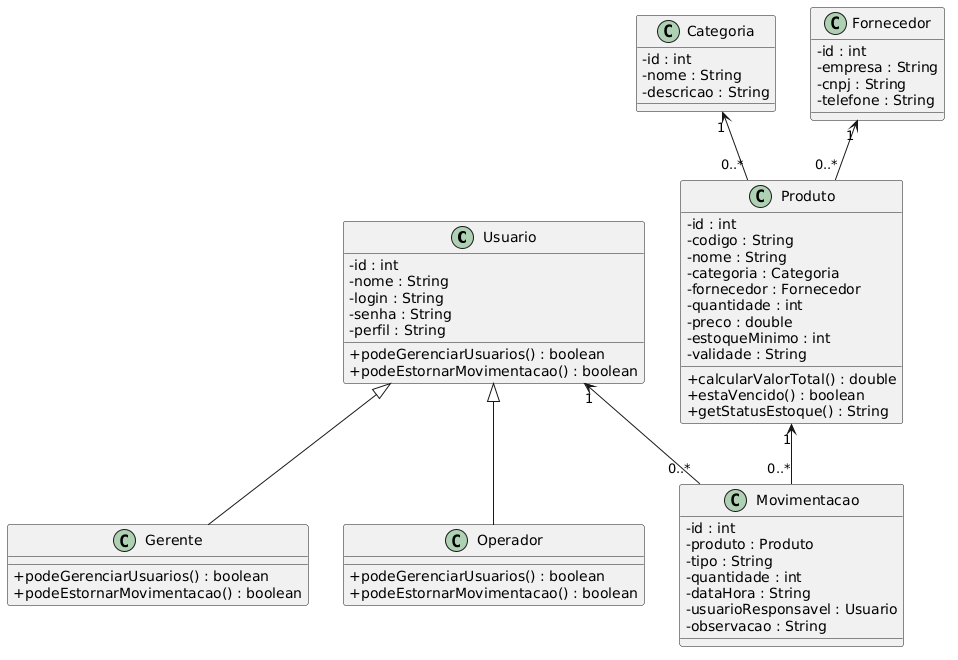
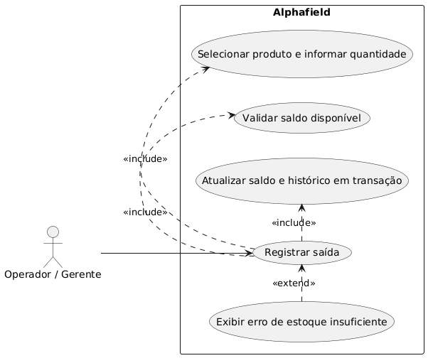
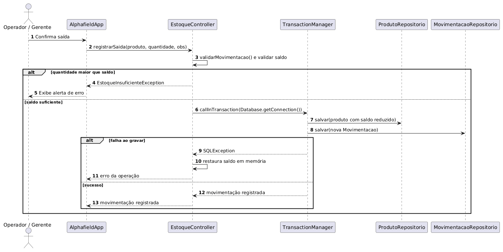

# Alphafield — Sistema de Controle de Estoque para Mercearias (Grupo 1)

> **Universidade Federal de Goiás (UFG) — Engenharia de Computação**  
> **Disciplina:** Programação Orientada a Objetos (POO) | **Docente:** Prof. Marcelo Akira Inuzuka  
> **Status em 18/11/2026:** Etapa 1 em execução — conclusão planejada para 02/12/2026

---

## Seção 1 — Introdução

### 1.1. Contextualização e descrição do problema

Pequenas mercearias de bairro frequentemente controlam suas mercadorias de forma manual em cadernos ou planilhas isoladas. Esse processo acarreta problemas operacionais constantes:

1. **Ruptura de estoque:** ausência de alertas automáticos quando um produto atinge sua quantidade mínima de segurança.
2. **Perdas por perecibilidade:** falta de acompanhamento sistemático das datas de validade dos lotes nas prateleiras.
3. **Divergências de saldo:** erros manuais ao somar entradas de fornecedores, registrar baixas diárias ou estornar lançamentos equivocados.

### 1.2. Justificativa e motivação

Concebido inicialmente como um protótipo estruturado em linguagem C no semestre anterior, o **Alphafield** foi remodelado sob o paradigma da **Programação Orientada a Objetos em Java**. A motivação central é oferecer um software desktop ágil, intuitivo e independente de internet para computadores de balcão, aplicando encapsulamento, herança, polimorfismo, `ArrayList`, exceções personalizadas, ORMLite/SQLite e arquitetura em camadas (MVC).

### 1.3. Soluções semelhantes e referências técnicas

- **Programa NEX (Nextar):** referência para cadastro ágil de produtos e fornecedores, entrada/saída e alerta visual de estoque mínimo.
- **MarketUP:** referência para organização por categorias e painel analítico do inventário.
- **Kyte:** referência para catálogo enxuto e diferenciação de perfis de operadores.
- **LGPD e ISO/IEC 25010:** referência para minimizar os dados cadastrais, facilitar o uso da interface e tornar o saldo mais confiável.

---

## Seção 2 — Plano do Projeto

### 2.1. Objetivo geral

Desenvolver uma aplicação desktop em Java com interface gráfica em **JavaFX** e persistência em **SQLite via ORMLite** para o gerenciamento completo de estoque de pequenas mercearias, organizada nos pacotes `model`, `repository`, `controller`, `view` e `exception`.

### 2.2. Objetivos específicos

1. **Implementar cinco módulos CRUD completos:** Categoria, Fornecedor, Usuário, Produto e Movimentação.
2. **Identificação dinâmica e polimorfismo de sessão:** validar nome, login e senha no início da execução e instanciar `Gerente` ou `Operador` de acordo com o perfil realmente salvo para o usuário.
3. **Abordagem híbrida:** persistir com `Dao<T, Integer>` do ORMLite e carregar registros em `ArrayList` para buscas, filtros, ordenações e cálculos.
4. **Robustez com exceções personalizadas:** validar entradas e permissões com `DadosInvalidosException`, `EstoqueInsuficienteException` e `OperacaoNaoPermitidaException`.
5. **Autenticação local simples:** conferir login e senha no SQLite e aplicar permissões por perfil. Nesta etapa acadêmica não há criptografia de senha, JWT ou autenticação remota.

### 2.3. Evolução técnica: JavaFX e BlueJ

Após as aulas práticas de JavaFX com banco de dados, ORM e collections, a equipe adotou **JavaFX + ORMLite/SQLite + ArrayList**. Para garantir compilação no **BlueJ**, a interface (`AlphafieldApp`) e os estilos (`EstiloVisual`) foram construídos em classes Java puras, sem FXML, CSS externo ou `module-info.java`.

---

## Seção 3 — Divisão de Tarefas, Responsabilidades e Prazos

| Integrante | GitHub | Cargo | Responsabilidades e módulos | Issues (Etapa 1) |
| :--- | :--- | :--- | :--- | :--- |
| **Pedro Henrique Machado Benício** | `@phmbenicio` | **Líder (Maintainer)** | Gestão de branches/PRs e Kanban, `Database.java`, movimentações e `EstoqueController.java`. | `#1`, `#2`, `#3` |
| **Ian Nascimento Santos Costa e Souza** | `@ianz3` | **Arquiteto** | UML em PlantUML, documentação, `Categoria.java`, `CategoriaRepositorio.java` e `UsuarioRepositorio.java`. | `#12`, `#13` |
| **Marcelo Soares Martins** | `@msoaresmartins` | **QA / Testes** | Exceções personalizadas e hierarquia `Usuario`, `Gerente` e `Operador`. | `#10`, `#11` |
| **João Pedro Moreira Cavalcante** | `@xXJpm4Xx` | **Frontend** | `EstiloVisual.java`, `AlphafieldApp.java`, painel, `PieChart`, `TableView` e modais. | `#7`, `#8`, `#9` |
| **João Guilherme Passos Rocha de Andrade** | `@52joaog22` | **Backend** | Produto, fornecedor, repositórios e buscas/filtros com `ArrayList`. | `#4`, `#5`, `#6` |

### 3.1. Cronograma Diário de Execução e Commits (18/11/2026 a 02/12/2026)

O trabalho será integrado em pequenas entregas diárias. Os cinco Pull Requests de modelagem são concluídos até **22/11/2026**, antes do prazo do LAB em 23/11. Os 13 commits da Etapa 1 terminam em **02/12/2026**, dois dias antes do prazo final de 04/12.

| Entrega | Responsável | PR / commit previsto | Issue(s) |
| --- | --- | --- | --- |
| Diagrama de classes do domínio e configuração inicial do projeto | Ian / Pedro | PR UML 01; Commit 01 `chore: estrutura inicial e dependências SQLite/ORMLite` | #12, #1 |
| Sequência de saída de estoque e exceções personalizadas | Pedro / Marcelo | PR UML 02; Commit 02 `feat(exception): cria exceções personalizadas` | #12, #10 |
| Modelagem do módulo de produtos e hierarquia de usuários | João Guilherme / Marcelo | PR UML 03; Commit 03 `feat(model): implementa Usuario, Gerente e Operador` | #4, #11 |
| Casos de uso do operador e entidade Categoria | João Pedro / Ian | PR UML 04; Commit 04 `feat(model): implementa Categoria` | #12, #13 |
| Herança/exceções do gerente e entidades Produto/Fornecedor | Marcelo / João Guilherme | PR UML 05; Commit 05 `feat(model): implementa Produto e Fornecedor` | #12, #4, #5 |
| Movimentação e conexão SQLite | Pedro | Commit 06 `feat(database): implementa Movimentacao e conexão ORMLite` | #1, #2 |
| Repositórios de Categoria e Usuário | Ian | Commit 07 `feat(repository): implementa CategoriaRepositorio e UsuarioRepositorio` | #13 |
| Repositório de Fornecedor | João Guilherme | Commit 08 `feat(repository): implementa FornecedorRepositorio` | #5 |
| Repositório de Produto, filtros e somatórios | João Guilherme | Commit 09 `feat(repository): implementa ProdutoRepositorio e filtros ArrayList` | #4, #6 |
| Repositório de movimentações e regras do controlador | Pedro | Commit 10 `feat(controller): implementa MovimentacaoRepositorio e EstoqueController` | #2, #3 |
| Testes interativos e validação dos fluxos da Etapa 1 | Marcelo | Commit 11 `test: adiciona TesteSistema e valida exceções` | #10, #11 |
| Identidade visual JavaFX | João Pedro | Commit 12 `style(view): cria EstiloVisual` | #7 |
| Telas JavaFX, painel, tabelas e revisão de integração | João Pedro / Pedro | Commit 13 `feat(view): implementa AlphafieldApp e revisão da Etapa 1` | #8, #9, #3 |

O `TesteSistema.java` base, com testes interativos e validação dos fluxos principais, integra o **Commit 11 da Etapa 1**. As Issues **#14** (refinamentos de filtros e badges) e **#15** (ampliação da suíte de QA com cenários de regressão) continuam planejadas somente para a **Etapa 2**, iniciada após 04/12/2026. Elas não fazem parte dos 13 commits acima.


---

## Seção 4 — Modelagem Inicial (UML com PlantUML)

Os artefatos detalhados da atividade **[LAB] AT-11-17: Básico de UML com PlantUML** estão na pasta [`docs/uml/`](./docs/uml/):

- [01 — Diagrama de Classes do Domínio (Ian Nascimento)](./docs/uml/01_uml_ian_classes.md)
- [02 — Diagrama de Sequência e Caso de Uso: Saída de Estoque (Pedro Henrique)](./docs/uml/02_uml_pedro_sequencia.md)
- [03 — Diagrama de Classes e Caso de Uso: Módulo de Produtos (João Guilherme)](./docs/uml/03_uml_joao_guilherme_produto.md)
- [04 — Diagrama de Caso de Uso (Operador) e Sequência de Sessão (João Pedro)](./docs/uml/04_uml_joao_pedro_casos_uso.md)
- [05 — Diagrama de Classes (Herança e Exceções) e Caso de Uso: Gerente (Marcelo Soares)](./docs/uml/05_uml_marcelo_heranca_excecoes.md)

### 4.1. Diagrama de classes geral



### 4.2. Diagrama de casos de uso



### 4.3. Diagrama de sequência — saída de estoque



```

---


## Fluxo de Branches e Pull Requests

As branches usam os prefixos `feat/`, `fix/` ou `refactoring/` e são integradas à `main` por Pull Request revisado pelo Líder (Maintainer). As issues `#1` a `#13` pertencem à Etapa 1; as issues `#14` e `#15` ficam abertas para a Etapa 2.

| Branch | Responsável | Principais issues |
| --- | --- | --- |
| `feat/excecoes-usuarios` | Marcelo | #10, #11 |
| `feat/categorias-uml` | Ian | #12, #13 |
| `feat/produtos-fornecedores` | João Guilherme | #4, #5, #6 |
| `feat/movimentacoes-controller` | Pedro | #1, #2, #3 |
| `feat/interface-javafx` | João Pedro | #7, #8, #9 |
