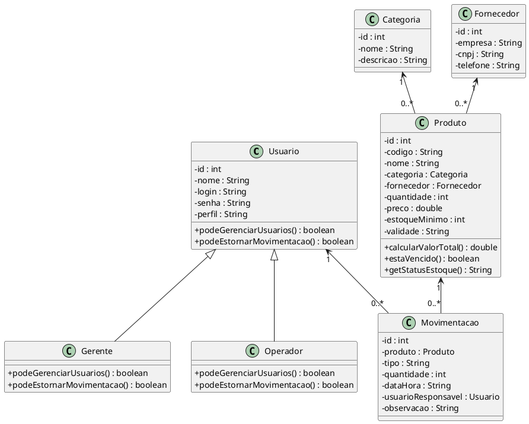

# 01 — Diagrama de Classes do Domínio

**Responsável:** Ian Nascimento Santos Costa e Souza (`@ianz3`)  
**Atividade:** [LAB] AT-11-17 — Básico de UML com PlantUML

Este diagrama apresenta as entidades do sistema, a herança de usuários e os relacionamentos principais usados pelo controle de estoque.

### Visualização do Diagrama
