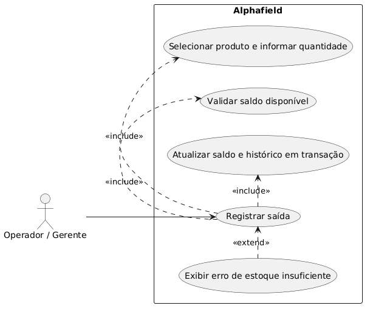
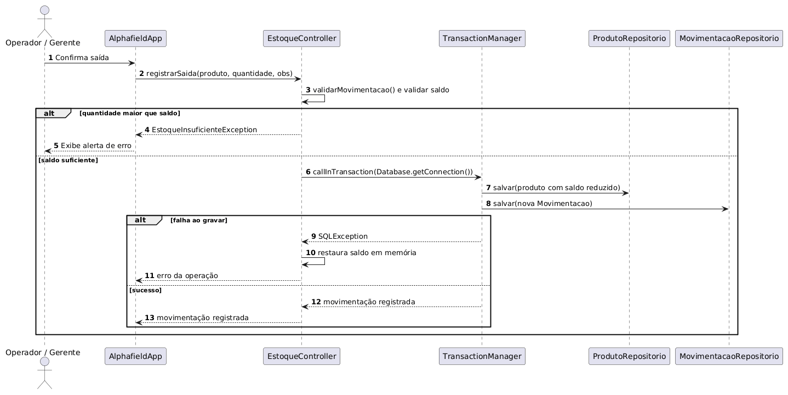

# 02 — Saída de Estoque: Sequência e Caso de Uso

**Responsável:** Pedro Henrique Machado Benício (@phmbenicio)  
**Atividade:** [LAB] AT-11-17 — Básico de UML com PlantUML

## Caso de uso

~~~plantuml
@startuml
left to right direction
actor "Operador / Gerente" as Usuario

rectangle "Alphafield" {
  usecase "Registrar saída" as UC1
  usecase "Selecionar produto e informar quantidade" as UC2
  usecase "Validar saldo disponível" as UC3
  usecase "Atualizar saldo e histórico em transação" as UC4
  usecase "Exibir erro de estoque insuficiente" as UC5
}

Usuario --> UC1
UC1 .> UC2 : <<include>>
UC1 .> UC3 : <<include>>
UC1 .> UC4 : <<include>>
UC5 .> UC1 : <<extend>>
@enduml
~~~

## Diagrama de sequência

~~~plantuml
@startuml
autonumber
actor "Operador / Gerente" as U
participant "AlphafieldApp" as V
participant "EstoqueController" as C
participant "TransactionManager" as TM
participant "ProdutoRepositorio" as PR
participant "MovimentacaoRepositorio" as MR

U -> V : Confirma saída
V -> C : registrarSaida(produto, quantidade, obs)
C -> C : validarMovimentacao() e validar saldo
alt quantidade maior que saldo
  C --> V : EstoqueInsuficienteException
  V --> U : Exibe alerta de erro
else saldo suficiente
  C -> TM : callInTransaction(Database.getConnection())
  TM -> PR : salvar(produto com saldo reduzido)
  TM -> MR : salvar(nova Movimentacao)
  alt falha ao gravar
    TM --> C : SQLException
    C -> C : restaura saldo em memória
    C --> V : erro da operação
  else sucesso
    TM --> C : movimentação registrada
    C --> V : movimentação registrada
  end
end
@enduml
~~~

