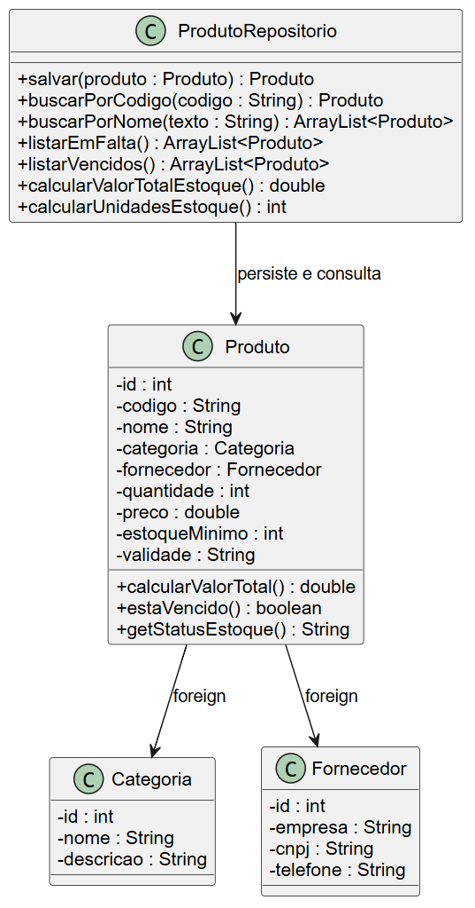
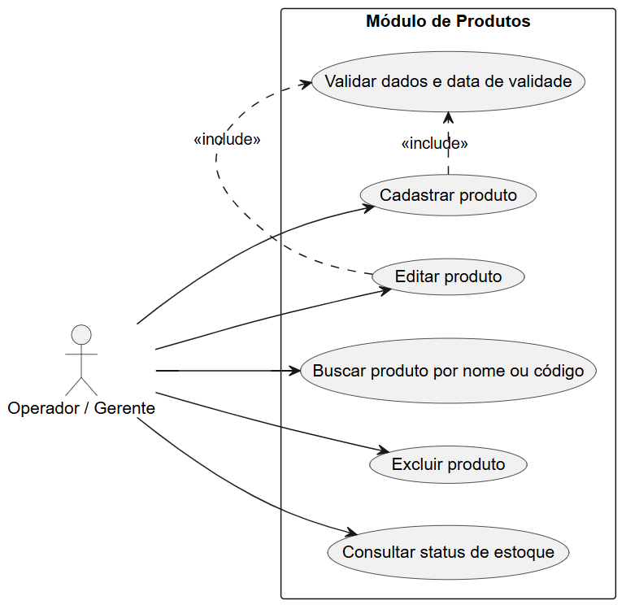

# 03 — Módulo de Produtos: Classes e Caso de Uso

**Responsável:** João Guilherme Passos Rocha de Andrade (@52joaog22)  
**Atividade:** [LAB] AT-11-17 — Básico de UML com PlantUML

## Diagrama de classes do módulo

~~~plantuml
@startuml
skinparam classAttributeIconSize 0

class Produto {
  - id : int
  - codigo : String
  - nome : String
  - categoria : Categoria
  - fornecedor : Fornecedor
  - quantidade : int
  - preco : double
  - estoqueMinimo : int
  - validade : String
  + calcularValorTotal() : double
  + estaVencido() : boolean
  + getStatusEstoque() : String
}

class Categoria {
  - id : int
  - nome : String
  - descricao : String
}

class Fornecedor {
  - id : int
  - empresa : String
  - cnpj : String
  - telefone : String
}

class ProdutoRepositorio {
  + salvar(produto : Produto) : Produto
  + buscarPorCodigo(codigo : String) : Produto
  + buscarPorNome(texto : String) : ArrayList<Produto>
  + listarEmFalta() : ArrayList<Produto>
  + listarVencidos() : ArrayList<Produto>
  + calcularValorTotalEstoque() : double
  + calcularUnidadesEstoque() : int
}

Produto --> Categoria : foreign
Produto --> Fornecedor : foreign
ProdutoRepositorio --> Produto : persiste e consulta
@enduml
~~~

## Caso de uso do produto

~~~plantuml
@startuml
left to right direction
actor "Operador / Gerente" as Usuario

rectangle "Módulo de Produtos" {
  usecase "Cadastrar produto" as UC1
  usecase "Editar produto" as UC2
  usecase "Buscar produto por nome ou código" as UC3
  usecase "Excluir produto" as UC4
  usecase "Consultar status de estoque" as UC5
  usecase "Validar dados e data de validade" as UC6
}

Usuario --> UC1
Usuario --> UC2
Usuario --> UC3
Usuario --> UC4
Usuario --> UC5
UC1 .> UC6 : <<include>>
UC2 .> UC6 : <<include>>
@enduml
~~~

