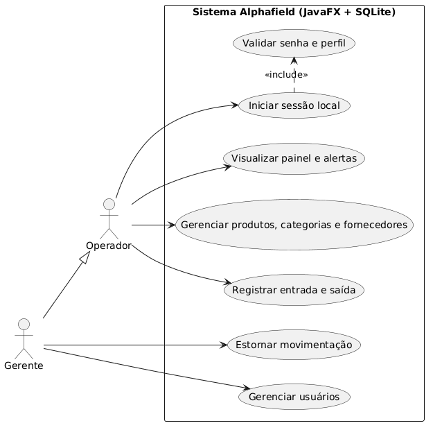
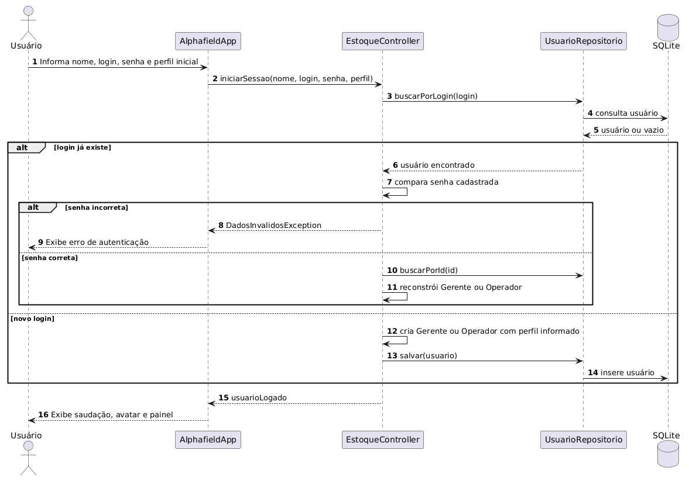

# 04 — Operador: Casos de Uso e Sequência de Sessão

**Responsável:** João Pedro Moreira Cavalcante (@xXJpm4Xx)  
**Atividade:** [LAB] AT-11-17 — Básico de UML com PlantUML

## Diagrama de casos de uso

~~~plantuml
@startuml
left to right direction
actor "Operador" as Op
actor "Gerente" as Ger
Ger --|> Op

rectangle "Sistema Alphafield (JavaFX + SQLite)" {
  usecase "Iniciar sessão local" as UC1
  usecase "Visualizar painel e alertas" as UC2
  usecase "Gerenciar produtos, categorias e fornecedores" as UC3
  usecase "Registrar entrada e saída" as UC4
  usecase "Estornar movimentação" as UC5
  usecase "Gerenciar usuários" as UC6
  usecase "Validar senha e perfil" as UC7
}

Op --> UC1
Op --> UC2
Op --> UC3
Op --> UC4
Ger --> UC5
Ger --> UC6
UC1 .> UC7 : <<include>>
@enduml
~~~

## Diagrama de sequência da sessão

~~~plantuml
@startuml
autonumber
actor "Usuário" as U
participant "AlphafieldApp" as V
participant "EstoqueController" as C
participant "UsuarioRepositorio" as UR
database "SQLite" as DB

U -> V : Informa nome, login, senha e perfil inicial
V -> C : iniciarSessao(nome, login, senha, perfil)
C -> UR : buscarPorLogin(login)
UR -> DB : consulta usuário
DB --> UR : usuário ou vazio
alt login já existe
  UR --> C : usuário encontrado
  C -> C : compara senha cadastrada
  alt senha incorreta
    C --> V : DadosInvalidosException
    V --> U : Exibe erro de autenticação
  else senha correta
    C -> UR : buscarPorId(id)
    C -> C : reconstrói Gerente ou Operador
  end
else novo login
  C -> C : cria Gerente ou Operador com perfil informado
  C -> UR : salvar(usuario)
  UR -> DB : insere usuário
end
C --> V : usuarioLogado
V --> U : Exibe saudação, avatar e painel
@enduml
~~~

