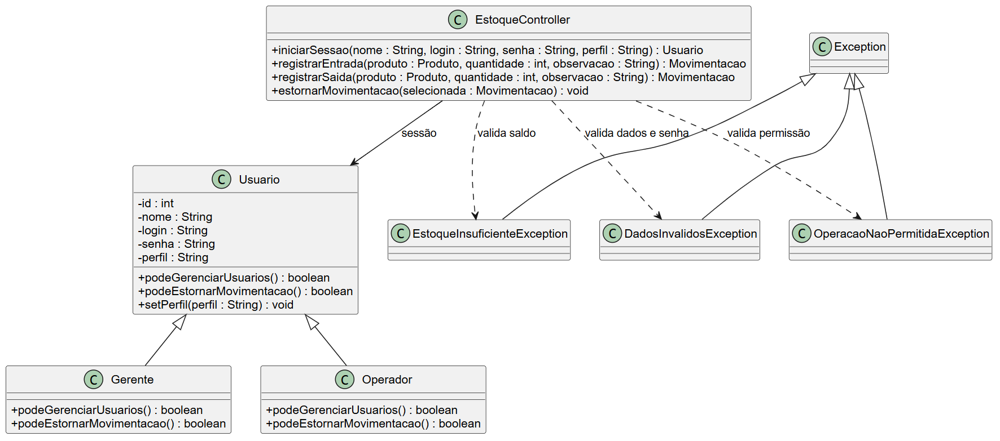
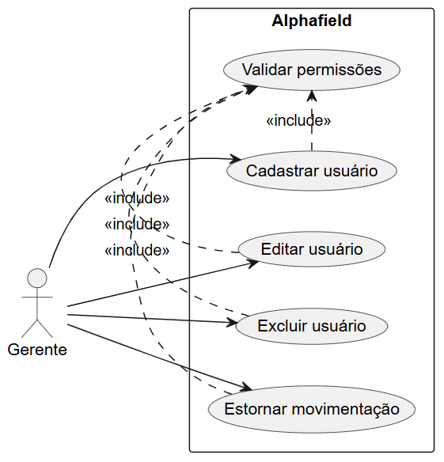

# 05 — Herança, Exceções e Caso de Uso do Gerente

**Responsável:** Marcelo Soares Martins (@msoaresmartins)  
**Atividade:** [LAB] AT-11-17 — Básico de UML com PlantUML

## Diagrama de classes: herança e exceções

~~~plantuml
@startuml
skinparam classAttributeIconSize 0

class Usuario {
  - id : int
  - nome : String
  - login : String
  - senha : String
  - perfil : String
  + podeGerenciarUsuarios() : boolean
  + podeEstornarMovimentacao() : boolean
  + setPerfil(perfil : String) : void
}

class Gerente {
  + podeGerenciarUsuarios() : boolean
  + podeEstornarMovimentacao() : boolean
}

class Operador {
  + podeGerenciarUsuarios() : boolean
  + podeEstornarMovimentacao() : boolean
}

class DadosInvalidosException
class EstoqueInsuficienteException
class OperacaoNaoPermitidaException
class Exception
class EstoqueController {
  + iniciarSessao(nome : String, login : String, senha : String, perfil : String) : Usuario
  + registrarEntrada(produto : Produto, quantidade : int, observacao : String) : Movimentacao
  + registrarSaida(produto : Produto, quantidade : int, observacao : String) : Movimentacao
  + estornarMovimentacao(selecionada : Movimentacao) : void
}

Usuario <|-- Gerente
Usuario <|-- Operador
Exception <|-- DadosInvalidosException
Exception <|-- EstoqueInsuficienteException
Exception <|-- OperacaoNaoPermitidaException
EstoqueController --> Usuario : sessão
EstoqueController ..> DadosInvalidosException : valida dados e senha
EstoqueController ..> EstoqueInsuficienteException : valida saldo
EstoqueController ..> OperacaoNaoPermitidaException : valida permissão
@enduml
~~~

## Caso de uso do gerente

~~~plantuml
@startuml
left to right direction
actor "Gerente" as Ger

rectangle "Alphafield" {
  usecase "Cadastrar usuário" as UC2
  usecase "Editar usuário" as UC3
  usecase "Excluir usuário" as UC4
  usecase "Estornar movimentação" as UC5
  usecase "Validar permissões" as UC6
}

Ger --> UC2
Ger --> UC3
Ger --> UC4
Ger --> UC5
UC2 .> UC6 : <<include>>
UC3 .> UC6 : <<include>>
UC4 .> UC6 : <<include>>
UC5 .> UC6 : <<include>>
@enduml
~~~

O controlador da cópia experimental expõe cadastro, edição, exclusão e estorno separadamente. As permissões são conferidas em cada operação. Na main consultada em 20/11, os seis arquivos Java de exceções e usuários estavam integrados. O controlador e a tela de edição ainda pertenciam ao modelo de integração. O ZIP (5) valida o perfil em `Usuario.setPerfil`; a main consultada atribui o texto diretamente.

**Revisão 2, 20/11/2026.** O diagrama de classes mostra as assinaturas presentes na cópia experimental. O caso de uso descreve os quatro fluxos de gerente implementados nessa cópia e propostos para integração. Na consulta desta rodada, a main continha Usuario.java e os PRs 18 e 19 integrados; o caminho do controlador e o deste UML 05 ainda estavam ausentes. Os nove blocos UML da documentação foram renderizados em uma cópia separada.
